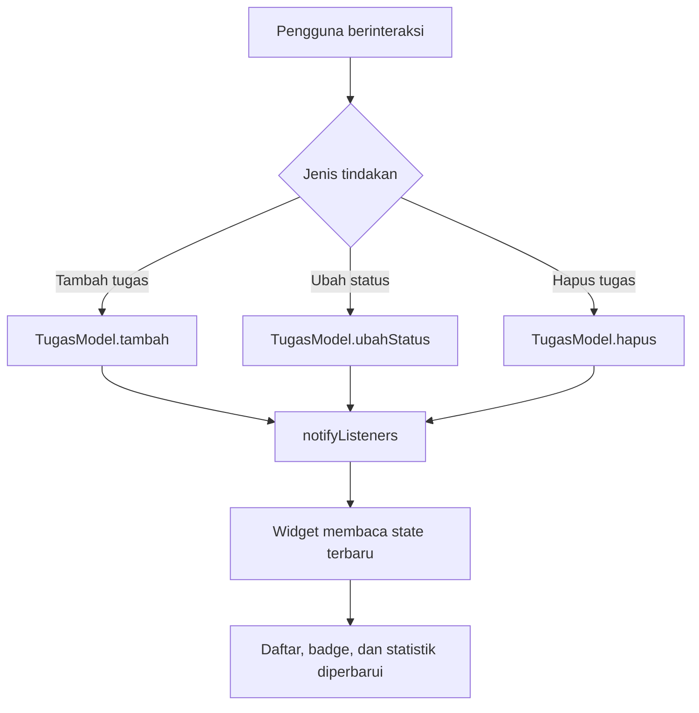

# Planner Tugas Kuliah

**Pemrograman Mobile – Pertemuan 7**

**Nama:** Syuhada Simbolon  
**NIM:** 4243550016  
**Universitas:** Universitas Negeri Medan

## Deskripsi Aplikasi

Planner Tugas Kuliah merupakan aplikasi Flutter untuk membantu mahasiswa mencatat dan memantau tugas perkuliahan. Pengguna dapat menambahkan tugas dengan informasi judul, mata kuliah, dan tenggat waktu. Aplikasi menyediakan fitur menandai tugas selesai, menghapus tugas, serta menyaring daftar berdasarkan status Semua, Aktif, dan Selesai.

## State Management

Aplikasi menggunakan **Provider** dengan `ChangeNotifier` untuk mengelola data tugas secara terpusat. Provider dipilih karena mudah diterapkan pada aplikasi berskala kecil hingga menengah dan memungkinkan beberapa halaman membaca data yang sama tanpa meneruskan parameter secara berulang.

`TugasModel` menyimpan daftar tugas dan menyediakan fungsi `tambah()`, `ubahStatus()`, serta `hapus()`. Setiap perubahan memanggil `notifyListeners()` agar widget yang menggunakan `context.watch()` dapat memperbarui tampilannya.

Filter tugas dikelola menggunakan `setState()` karena hanya memengaruhi tampilan halaman daftar, sedangkan data tugas digunakan bersama oleh halaman daftar dan statistik.

## Fitur Utama

- Menambahkan tugas beserta mata kuliah dan deadline.
- Menandai tugas sebagai selesai.
- Menghapus tugas.
- Filter Semua, Aktif, dan Selesai.
- Statistik total, aktif, selesai, dan persentase penyelesaian.
- Badge jumlah tugas aktif.
- Navigasi menggunakan `go_router`.

## Pengujian

Unit test disiapkan untuk memeriksa penambahan tugas, perubahan status, penghapusan, dan perhitungan statistik. Pengujian dijalankan menggunakan perintah `flutter test`.

## Penggunaan AI

AI digunakan sebagai alat bantu pembelajaran, penyusunan contoh implementasi Flutter, serta pembuatan skenario pengujian. Kode tetap perlu diperiksa dan diuji melalui Flutter sebelum dikumpulkan.

## Diagram Alur State Management

### Penjelasan Alur

Ketika pengguna menambahkan, menyelesaikan, atau menghapus tugas, aplikasi memanggil metode yang sesuai pada TugasModel. Setelah data berubah, notifyListeners() memberi tahu widget yang mendengarkan Provider. Widget kemudian membangun ulang bagian tampilan yang membutuhkan data terbaru, seperti daftar tugas, badge jumlah tugas aktif, dan statistik penyelesaian.
  